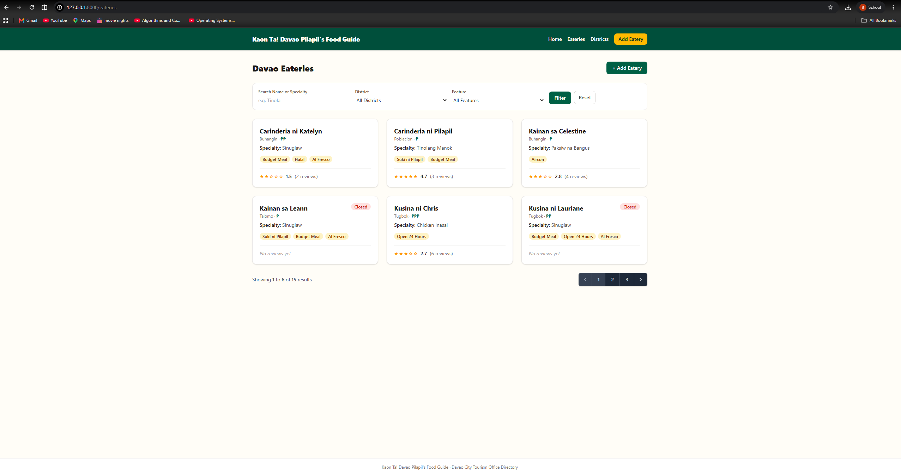
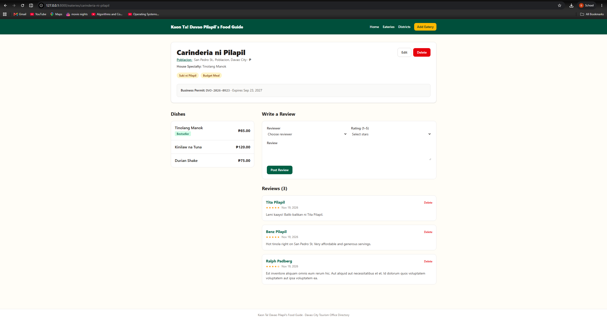
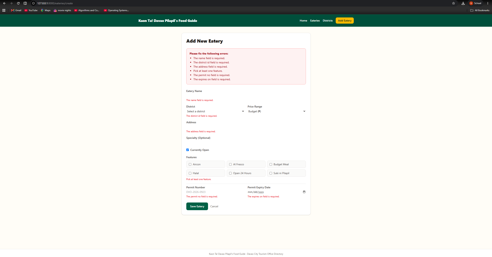

# Kaon Ta! Davao Pilapil's Food Guide

**Author:** Benz Pilapil  
**Course:** 4-334 CS Elective 2 Full-Stack Development (Laravel)  
**Repository:** `PrefinalProject-Pilapil-KaonTaDavao`

A Laravel 12 and SQLite web directory for Davao City carinderias and local eateries, showcasing business permits, signature dishes, eatery features, district listings, and community reviews.

---

## Setup Commands

Run the following commands from a fresh clone to install dependencies, configure SQLite, seed the database, build frontend assets, and start the development server:

```bash
composer install
cp .env.example .env
php artisan key:generate
touch database/database.sqlite
php artisan migrate:fresh --seed
npm install
npm run build
php artisan serve
# or npm run dev while developing
```

---

## Personalized Project Data

- **Site Title:** `Kaon Ta! Davao Pilapil's Food Guide`
- **Districts (6):** `Poblacion`, `Talomo`, `Agdao`, `Buhangin`, `Toril`, `Tugbok`
- **Features (6):** `Suki ni Pilapil`, `Budget Meal`, `Halal`, `Open 24 Hours`, `Aircon`, `Al Fresco`
- **Seeded Personal Users:**
  - `Benz Pilapil` — `pilapil@kaonta.test` (password: `kaonta2026`)
  - `Tita Pilapil` — `tita.pilapil@kaonta.test` (password: `kaonta2026`)
- **Hand-Made Eatery:**
  - **Name:** `Carinderia ni Pilapil`
  - **Slug:** `carinderia-ni-pilapil`
  - **District:** `Poblacion`
  - **Address:** `San Pedro St., Poblacion, Davao City`
  - **Price Range:** `budget` (`₱`)
  - **Specialty:** `Tinolang Manok`
  - **Features:** `Suki ni Pilapil`, `Budget Meal`
- **Business Permit:** `DVO-2026-0923` (Expires: `2027-09-23`)

---

## Eloquent Relationships

| Relationship | Type | Why This Type Fits |
| :--- | :--- | :--- |
| **District ↔ Eatery** | `hasMany` / `belongsTo` | One Davao district contains many eateries, while each individual eatery is located in a single district. |
| **Eatery ↔ Dish** | `hasMany` / `belongsTo` | An eatery serves multiple dishes on its menu, and each dish record belongs to the specific eatery that offers it. |
| **Eatery ↔ Review** | `hasMany` / `belongsTo` | Visitors can leave many reviews on a single eatery, and each review is written about one specific eatery. |
| **User ↔ Review** | `hasMany` / `belongsTo` | One resident can post multiple reviews across different eateries, while every review belongs to one author. |
| **Eatery ↔ Permit** | `hasOne` / `belongsTo` | Each eatery holds exactly one official city business permit, and that permit belongs exclusively to that eatery. |
| **Eatery ↔ Feature** | `belongsToMany` / `belongsToMany` (`eatery_feature`) | An eatery can have several tags like Halal or Aircon at once, and each feature tag applies to many different eateries. |
| **District → Review (via Eatery)** | `hasManyThrough` | Districts do not have a direct foreign key on reviews, so going through eateries lets us count all reviews posted within a district. |

---

## Route List (`php artisan route:list --except-vendor`)

```text
  GET|HEAD   / .......................................... home › HomeController
  GET|HEAD   districts ............. districts.index › DistrictController@index
  GET|HEAD   districts/{district} .... districts.show › DistrictController@show
  GET|HEAD   eateries ................ eateries.index › EateryController@index
  POST       eateries ................ eateries.store › EateryController@store
  GET|HEAD   eateries/create ....... eateries.create › EateryController@create
  GET|HEAD   eateries/{eatery} ......... eateries.show › EateryController@show
  PUT|PATCH  eateries/{eatery} ..... eateries.update › EateryController@update
  DELETE     eateries/{eatery} ... eateries.destroy › EateryController@destroy
  GET|HEAD   eateries/{eatery}/edit .... eateries.edit › EateryController@edit
  POST       eateries/{eatery}/reviews eateries.reviews.store › ReviewController@store
  GET|HEAD   reviewers/{user} ........ reviewers.show › ReviewerController@show
  DELETE     reviews/{review} ...... reviews.destroy › ReviewController@destroy

                                                            Showing [13] routes
```

---

## Screenshots

### 1. Eatery List (`/eateries`)


### 2. Eatery Page with Reviews (`/eateries/carinderia-ni-pilapil`)


### 3. Create Eatery Form with Validation Errors (`/eateries/create`)
